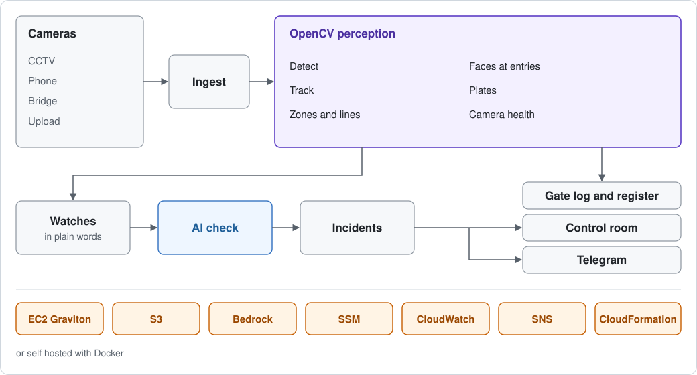
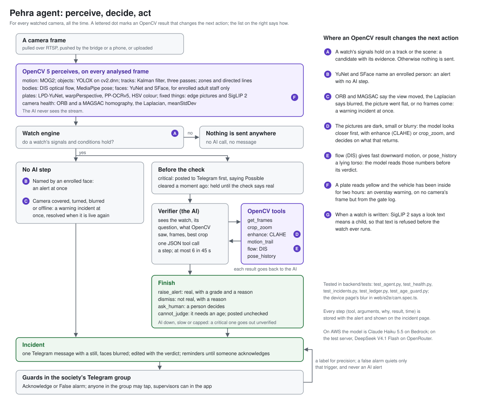

<!-- Made by docs/fill.py from docs/src/report.md. Edit that file, then run python3 docs/fill.py. -->

# Pehra technical report

Pehra is an AI control room for the CCTV cameras Indian housing societies already have, built on OpenCV 5 and AWS.
This short report covers how it is built, how OpenCV is used, how we evaluated it, and what it cannot do yet.

* Live demo: https://pehra.dijmo.com (press Try the demo)
* Video: not set yet
* Code: https://github.com/inventionsbyhamid/pehra

Every measured number here is filled in by `docs/fill.py` from a file in `eval/results/` and links to it. A number we
have not measured says "not measured yet". Settings and design figures are written plainly.

## 1. The problem

A housing society runs dozens of cameras and nobody watches them. At best a guard glances at one monitor, and footage
is looked at after something goes wrong
([Studio Matrx](https://www.studiomatrx.org/guides/cctv-control-room-monitoring-india)). Cameras die quietly: at one
Kharar society about 150 of 350 worked
([The Tribune](https://www.tribuneindia.com/news/chandigarh/residents-flag-rise-in-thefts-at-kharar-society/amp)).
Children have drowned in society pools left unattended
([The Tribune](https://www.tribuneindia.com/news/delhi/5-year-old-boy-drowns-in-gurugram-society-pool-643276),
[Deccan Herald](https://www.deccanherald.com/india/karnataka/bengaluru/seven-year-old-girl-drowns-in-swimming-pool-in-bengaluru-apartment-3062765)).
Gate apps log what guards type, not what cameras see
([MyGate help](https://help.mygate.in/articles/134062-why-are-the-visitors-still-coming-to-my-flat-without-my-approval)).

Pehra is for the committee or facility manager, who sets it up; the security supervisor, who reads the alerts and the
logs; and the guards in the society's Telegram group, who get alerts and can answer them without an account. No
society has used Pehra yet. The need comes from the reports above, not from our own users.

## 2. What it does

* A control room: every camera on one wall with a health dot, and one feed of incidents.
* Watches in plain words. "Someone in the water after pool hours" is compiled into general signals. Before saving,
  a card shows what will be watched and how reliably, what cannot be watched and the nearest alternative, the setup it
  needs, and how often it would have fired over the last 24 hours of that camera.
* An AI check of each flagged moment, by an agent that uses OpenCV tools. The AI never watches a stream.
* Graded alerts on Telegram, with a still picture, faces blurred, and Acknowledge and False alarm buttons.
* A gate log of vehicles by plate, a register of consenting adult staff (first seen and last seen each day; came in
  and went out only from crossing a line drawn with a direction), and alerts for cameras that go offline or are
  covered, turned or blurred.
* Cameras over RTSP, through a small bridge for recorders behind a router, from a phone or laptop browser (faces
  blurred on the device first), or as an uploaded video.

## 3. Architecture



One Python service (FastAPI) holds the society API, sign in, live sockets and the AI check. Camera processes, one per
CPU by default, each run the OpenCV pipeline for several cameras. Scan workers take uploads in time chunks. A job
worker sends Telegram messages, makes blurred stills and the daily summary, and deletes old footage. Every row, file
and socket belongs to one society. Replaceable parts (detector, pose, faces, image model, AI, storage, database,
alerts, metrics) are registered by name and picked by a setting. The [detailed architecture](architecture.svg) and
the [agent workflow](agent-workflow.svg) show every piece.

## 4. How OpenCV is used

Every pixel step goes through OpenCV 5: `opencv-python-headless` 5.0.0.93 in development and on the demo server,
COOL's build on Graviton on AWS, and OpenCV.js 5.0 in the browser. One exception is deliberate. SigLIP 2, the image
and text model for looks described in words, runs its forward pass on ONNX Runtime by default. On OpenCV DNN its image
tower added [828 MB](../eval/results/build_measurements.json "pool.siglip.image_opencv_mb") to a process, on ONNX Runtime [400 MB](../eval/results/build_measurements.json "pool.siglip.image_ort_mb"),
with the same vectors (cosine [1.0000](../eval/results/build_measurements.json "pool.siglip.cosine")). Its preprocessing stays in OpenCV, and
`EMBEDDER_RUNTIME=opencv` moves it back to `cv2.dnn`.

On each analysed frame (5 frames a second by default, at 960 px wide):

1. **Read.** `VideoCapture` with FFmpeg, or `imdecode` for pushed pictures after checking their size from the header;
   `resize` with `INTER_AREA`.
2. **Night.** A dark frame gets CLAHE on the lightness of Lab.
3. **Camera health.** Every few seconds a small grey copy is compared with a reference: `meanStdDev` for a covered
   lens, the variance of the `Laplacian` for blur, and ORB with a ratio test and a `USAC_MAGSAC` homography for a
   turned camera.
4. **Motion gate.** MOG2 on a blurred small copy, opening, dilation and contours. A still frame with nothing tracked
   skips the detector.
5. **Detection.** YOLOX nano through `cv2.dnn`, with `NMSBoxesBatched`.
6. **Tracking.** A `KalmanFilter` per track and three association passes: two by overlap, then one by distance over
   time, size and class, with an HSV histogram to break ties. The third pass keeps ids at the low frame rates a busy
   server delivers (section 6.3).
7. **Zones and lines.** `pointPolygonTest` on the foot point; directed lines with hysteresis, so a crossing counts
   once.
8. **Only when a watch needs it.** MediaPipe pose through `cv2.dnn` on an upright crop (`warpAffine`); YuNet and SFace
   on entry cameras; DIS optical flow inside a box against the flow around it (a still body in moving water); plates
   on vehicles near a gate line.

A watch is data: a subject, signals with conditions, hours, a severity and a question for the checker. Nothing about
pools or gates is in the code. The signals are general: presence, entering, crossing, dwell, count, still, vanished in
a zone, alone, a zone's state, looks described in words, plate attributes, speed, posture and camera health. A zone's
state (a gate open or closed) is matched against saved example pictures through a blurred CLAHE `Sobel` edge picture
and `matchTemplate`. The compiler checks every watch the AI writes against each signal's contract, so a watch that
saves can fire. With the real AI, [14](../eval/results/build_measurements.json "compile.generic") of [14](../eval/results/build_measurements.json "compile.requests") plain words requests
compiled into these signals with no new code.

**Plates.** `LPD-YuNet` through `cv2.dnn` finds the plate, `getPerspectiveTransform` and `warpPerspective` flatten it,
Otsu `threshold` splits two line plates, and `PP-OCRv5` reads each line through `cv2.dnn`, with the `PP-OCRv3` DB
detector (`TextDetectionModel_DB`) as a fallback. An Indian plate grammar fixes look alike characters, reads are voted
across frames, and a read under the confidence threshold stays unread. The colour comes from the HSV median of the
plate's background.

**Staff.** Three to five photos of a consenting adult become SFace templates; the photos are never stored. Matching
runs only on entry, gate and service door cameras.

**Privacy in the pixels.** Telegram stills pixelate every head that is not the enrolled person's, where pose or YuNet
finds it. On a phone used as a camera, OpenCV.js runs `FaceDetectorYN` on each frame and covers every face before the
picture is made; a frame is never sent unless detection ran on it.

## 5. The AI check



Rules decide in code whether a moment is worth a look. Some moments never reach the AI: camera health and enrolled
faces are measured by OpenCV and filed at once. A critical moment goes to Telegram before the check, and the verdict
edits the message.

The checker (`agent/verifier.py`) sees the watch, what OpenCV saw and a few pictures, and answers with one tool call
a step. Each result goes back to it with any new picture, for at most 6 steps and 45 s.

| Tool | What it runs |
| --- | --- |
| `get_frames(from_s, to_s, n)` | Frames around the moment with the zones and box drawn (`polylines`) |
| `crop_zoom(at_s)` | The object enlarged with `INTER_CUBIC` and an unsharp mask (`GaussianBlur`, `addWeighted`) |
| `enhance(image, kind)` | CLAHE, `fastNlMeansDenoisingColored` or sharpening |
| `motion_trail()` | The path walked, drawn on the latest frame |
| `flow(from_s, to_s)` | DIS optical flow in the box between frames at most 0.6 s apart |
| `pose_history(seconds)` | The torso angle over time from MediaPipe pose |

It finishes by raising the alert with a grade and a reason, dismissing it, asking a person, or saying it cannot judge
because the question needs an age. If the AI is down, a reply is broken or the day's limit is used up, the moment is
still filed as an incident marked not checked by the AI. Each society has a daily limit, and so does the whole server.

We sent one flagged Plaza moment to the real model ([openrouter: deepseek/deepseek-v4.1-flash](../eval/results/agent-trace-plaza.json "model")) four times: twice as filmed, twice dimmed
to [15%](../eval/results/agent-trace-plaza_dark.json "dark") of its brightness. Every run raised the alert. On the dimmed pictures it looked closer
first ([get_frames, crop_zoom, flow, raise_alert](../eval/results/agent-trace-plaza_dark.json "runs.0.tools")); as filmed it did not ([get_frames, flow, raise_alert](../eval/results/agent-trace-plaza.json "runs.0.tools")). That shows the loop on one
moment; it does not measure the agent's accuracy. Those runs also showed a bug: `flow` compared frames seconds apart
and read "[median motion inside the box: -0.00 body heights per second downward, -0.00 sideways](../eval/results/agent-trace-plaza.json "runs.0.steps.1.result")" for a walking person. It now compares neighbouring frames and says when they
are too far apart. The traces were recorded before that fix.

## 6. Evaluation

### 6.1 Method

We have one labelled clip: OpenCV's sample `vtest.avi`, a busy plaza seen from above ([80 s](../eval/results/eval-plaza.json "duration_s")), the
same scene the demo camera plays. It is not a society camera. One of us labelled it by eye: every time someone's feet
entered the left walkway (`enter`, [19](../eval/results/eval-plaza.json "truth.enter") events), and every crossing of its edge going in
(`cross_in`, [18](../eval/results/eval-plaza.json "truth.cross_in")) or out (`cross_out`, [12](../eval/results/eval-plaza.json "truth.cross_out")).
`python eval/evaluate.py eval/labels/plaza.csv --fps 10,2,1` plays the clip through a camera process's own code and
every candidate through the app's own path, with a stand in for the AI that calls every moment real. A candidate
matches a label within [2 s](../eval/results/eval-plaza.json "tolerance_s"). Intervals are Wilson at 95%.

### 6.2 Results

| Watch, 2 fps | Labelled | Matched | False alarms | Missed | Precision | Recall |
| --- | --- | --- | --- | --- | --- | --- |
| Enters the left walkway | [19](../eval/results/eval-plaza.json "runs.fps_2.watches.enter.truth") | [14](../eval/results/eval-plaza.json "runs.fps_2.watches.enter.tp") | [2](../eval/results/eval-plaza.json "runs.fps_2.watches.enter.fp") | [5](../eval/results/eval-plaza.json "runs.fps_2.watches.enter.fn") | [88%](../eval/results/eval-plaza.json "runs.fps_2.watches.enter.precision.value") | [74%](../eval/results/eval-plaza.json "runs.fps_2.watches.enter.recall.value") |
| Crosses going in | [18](../eval/results/eval-plaza.json "runs.fps_2.watches.cross_in.truth") | [13](../eval/results/eval-plaza.json "runs.fps_2.watches.cross_in.tp") | [2](../eval/results/eval-plaza.json "runs.fps_2.watches.cross_in.fp") | [5](../eval/results/eval-plaza.json "runs.fps_2.watches.cross_in.fn") | [87%](../eval/results/eval-plaza.json "runs.fps_2.watches.cross_in.precision.value") | [72%](../eval/results/eval-plaza.json "runs.fps_2.watches.cross_in.recall.value") |
| Crosses going out | [12](../eval/results/eval-plaza.json "runs.fps_2.watches.cross_out.truth") | [9](../eval/results/eval-plaza.json "runs.fps_2.watches.cross_out.tp") | [2](../eval/results/eval-plaza.json "runs.fps_2.watches.cross_out.fp") | [3](../eval/results/eval-plaza.json "runs.fps_2.watches.cross_out.fn") | [82%](../eval/results/eval-plaza.json "runs.fps_2.watches.cross_out.precision.value") | [75%](../eval/results/eval-plaza.json "runs.fps_2.watches.cross_out.recall.value") |

| Every watch together | 10 fps | 2 fps | 1 fps |
| --- | --- | --- | --- |
| Precision | [93%](../eval/results/eval-plaza.json "runs.fps_10.all.precision.value") ([81% to 97%](../eval/results/eval-plaza.json "runs.fps_10.all.precision.wilson95")) | [86%](../eval/results/eval-plaza.json "runs.fps_2.all.precision.value") ([72% to 93%](../eval/results/eval-plaza.json "runs.fps_2.all.precision.wilson95")) | [84%](../eval/results/eval-plaza.json "runs.fps_1.all.precision.value") ([71% to 92%](../eval/results/eval-plaza.json "runs.fps_1.all.precision.wilson95")) |
| Recall | [78%](../eval/results/eval-plaza.json "runs.fps_10.all.recall.value") ([64% to 87%](../eval/results/eval-plaza.json "runs.fps_10.all.recall.wilson95")) | [73%](../eval/results/eval-plaza.json "runs.fps_2.all.recall.value") ([60% to 84%](../eval/results/eval-plaza.json "runs.fps_2.all.recall.wilson95")) | [78%](../eval/results/eval-plaza.json "runs.fps_1.all.recall.value") ([64% to 87%](../eval/results/eval-plaza.json "runs.fps_1.all.recall.wilson95")) |
| Candidates, incidents, AI checks | [45](../eval/results/eval-plaza.json "runs.fps_10.ai.candidates"), [3](../eval/results/eval-plaza.json "runs.fps_10.ai.incidents"), [3](../eval/results/eval-plaza.json "runs.fps_10.ai.checks") | [43](../eval/results/eval-plaza.json "runs.fps_2.ai.candidates"), [3](../eval/results/eval-plaza.json "runs.fps_2.ai.incidents"), [3](../eval/results/eval-plaza.json "runs.fps_2.ai.checks") | [46](../eval/results/eval-plaza.json "runs.fps_1.ai.candidates"), [3](../eval/results/eval-plaza.json "runs.fps_1.ai.incidents"), [3](../eval/results/eval-plaza.json "runs.fps_1.ai.checks") |

On a crowded scene the watches find about three of four labelled events at every rate, and precision drops only a
little as the rate drops. Grouping keeps the AI to one check per situation. A plain motion alarm cannot tell these
events apart: the plaza never stops moving, so on the whole clip it alerted this many times:
[1](../eval/results/eval-plaza.json "runs.fps_2.motion_alarm_alerts").

### 6.3 A failure we found and fixed

Our first shared camera pool gave about one analysed frame a second per camera on a loaded server. At that rate the
tracker lost people between frames: each walker became several ids, "enters" fired again and again, and line
crossings nearly vanished. The third association pass fixed it. For crossings going in at 1 fps, recall went
from [0%](../eval/results/eval-plaza_before_fix.json "runs.fps_1.watches.cross_in.recall.value") to [83%](../eval/results/eval-plaza.json "runs.fps_1.watches.cross_in.recall.value"), and distinct person ids
from [80](../eval/results/eval-plaza_before_fix.json "runs.fps_1.person_ids") to [24](../eval/results/eval-plaza.json "runs.fps_1.person_ids").
`backend/tests/test_track_plaza.py` keeps it fixed.

### 6.4 Failure cases

The evaluation saves the first false alarm and the first miss of each watch as pictures, with the tracker's boxes
drawn, in [eval/results/failures](../eval/results/failures/). What we know goes wrong:

* People walking close together, seen from above, merge into one box, so one of them is missed.
* At very low frame rates two people of the same size in similar clothes can swap ids.
* At the start of a clip, people already near a line are picked up as they first appear.
* A plate box that cuts characters can give a wrong but valid read.
* The age guard also refuses some harmless phrases, such as "a kids bicycle left on the ramp".

### 6.5 Plates, speed and memory

On [8](../eval/results/plates-commons.json "all.photos") Wikimedia Commons photos (handheld, daylight, not gate CCTV), the reader read
[5](../eval/results/plates-commons.json "all.exact") of [7](../eval/results/plates-commons.json "all.plates") plates exactly, [1](../eval/results/plates-commons.json "all.wrong") wrong, and left
[1](../eval/results/plates-commons.json "all.unread") unread. On a synthetic gate (a real car photo moved over a drawn gate),
[4](../eval/results/build_measurements.json "plates.gate_runs_paired") of [4](../eval/results/build_measurements.json "plates.gate_runs") runs logged one in and one out paired by plate.

`python eval/bench.py` runs the live camera pool on a busy Plaza clip. On our dev box (a 2013 Xeon without AVX2,
shared with other work), [8](../eval/results/bench-devbox_6cpu_no_text.json "scenario.cameras") cameras on [6](../eval/results/bench-devbox_6cpu_no_text.json "scenario.vcpus") CPUs
analysed [2.1 frames a second](../eval/results/bench-devbox_6cpu_no_text.json "fps.per_camera.median") per camera in [3,710 MB](../eval/results/bench-devbox_6cpu_no_text.json "memory_mb.total_median") in all.
A watch described by looks on every camera is the expensive case, since the image model looks at crops. Embedding only
the tracks and zones a watch uses, once per look, raised that case from [0.12 frames a second](../eval/results/bench-devbox_6cpu_text_before.json "fps.per_camera.median")
to [0.47 frames a second](../eval/results/bench-devbox_6cpu_text.json "fps.per_camera.median") per camera on 6 CPUs, and from
[0.05 frames a second](../eval/results/bench-devbox_2cpu_text_before.json "fps.per_camera.median") to [0.12 frames a second](../eval/results/bench-devbox_2cpu_text.json "fps.per_camera.median") on 2 CPUs. On this
CPU it stays under our goal of one analysed frame a second per camera. None of these numbers is from Graviton.

## 7. AWS and COOL

The production deployment is one CloudFormation stack in Mumbai (`ap-south-1`), built by `deploy/deploy.sh`. It has
not run on AWS yet. We test it with `cfn-lint`, moto and a fake `aws` command; a real deploy fills the checks below.

| Service | Its job |
| --- | --- |
| EC2 c8g.xlarge (Graviton4) from the COOL image | Runs everything; the live pipeline imports COOL's OpenCV 5 |
| S3 | Pictures, clips and a Litestream copy of the SQLite database. Object Lock is on for the bucket, but the app does not lock clips yet |
| Bedrock | Claude Haiku 5.5 through the global inference profile; the role may call only that model |
| SSM Parameter Store | Settings and secrets, loaded when each service starts |
| CloudWatch | Logs, metrics per camera process, a dashboard, six alarms |
| SNS | Alarm emails |
| CloudFormation and Budgets | The stack, and a monthly budget alarm |

The deploy proves itself. It fails unless `cv2` is loaded from under `/opt/cool` with KleidiCV in its build and
decodes H.264 and H.265, or if the app uses more memory than its budget. It then writes `eval/results/aws.json`:
OpenCV not measured yet, loaded from COOL not measured yet, KleidiCV not measured yet, memory not measured yet of
not measured yet. Running the instance is estimated at about [$105.00](../eval/results/build_measurements.json "estimates.aws_month_usd") a month at list
price, before Bedrock, S3 and transfer. That is an estimate, not a bill.

**COOL.** `eval/bench_aws.sh --yes-spend` starts temporary instances and runs the same camera pool benchmark on a
c8g.large with COOL, on the same instance with stock OpenCV 5.0.0.93, and on a c7i.large with stock OpenCV, then
terminates them. Every frame is resized, converted, blurred, run through MOG2 and morphology and often CLAHE, which is
the imgproc work COOL targets; the DNN forwards are most of a busy frame's time. COOL over stock OpenCV on the same
Graviton instance: not measured yet. Per camera on a c8g.large with COOL:
not measured yet. The run waits on the owner's go ahead.

The same app also runs anywhere with Docker. The root `Dockerfile` and `compose.yaml` build an image of
[4,254 MB](../eval/results/build_measurements.json "selfhost.image_mb") with every model, which we built and started on our own server.

## 8. Privacy and responsible use

* Faces only for consenting adult staff, matched only on entry, gate and service door cameras. Photos are never
  stored, and deleting a person reaches every camera process at once. Residents and visitors are never identified,
  and there is no search by photo.
* Never children. No child is enrolled, identified or aged. A watch about age is refused in layers: words in English,
  Hindi and other Indian languages and scripts, age and height patterns, a SigLIP 2 meaning check, and a flag the
  compiler model must set. The checker never states an age, and its text is checked again.
* Telegram gets stills, not video, with faces blurred. Clips stay behind sign in, by role, and every view is recorded.
* Footage, incidents and logs are deleted on each plan's schedule. A printable notice is made for each camera zone.
  Under India's DPDP Act the society is the data fiduciary and Pehra its processor.
* The AI sees only flagged moments, with daily caps per society and for the whole server. Alerts the AI checked say
  "Possible"; a person decides what to do. The site calls Pehra an aid, not a guarantee.

## 9. Limits and what is not done

* One labelled clip, labelled by one of us. No society, gate, pool or staff footage is labelled yet
  (`eval/record_checklist.md` is the plan).
* Every speed and memory number is from our x86 dev box. AWS, COOL and Graviton are not measured yet.
* The agent's accuracy is not measured: the evaluation used a stand in, and the real model ran on one moment.
* Thresholds for still in water, zone states and plates were set on rendered or sample pictures.
* `LPD-YuNet` was trained on Chinese plates. Older, army, diplomatic and temporary plates are left unread on purpose.
* Small, profile or infrared faces are often missed, so a still may show a pixelated person rather than a sharp scene.
* One server and one app worker; Postgres is planned and untested.
* Billing through Polar is tested against its SDK's types and has never been called. Telegram is tested against a
  mocked Bot API, and the demo server now has a real bot connected.

## 10. Reproduce

```
python scripts/fetch_assets.py                                # every model, checked by SHA 256
PYTHONPATH=backend pytest -q                                  # the backend tests
python eval/evaluate.py eval/labels/plaza.csv --fps 10,2,1    # section 6
python eval/bench.py --setup devbox --cameras 8 --cpus 2      # section 6.5
eval/bench_aws.sh                                             # the COOL plan and its cost; starts nothing
python3 docs/fill.py                                          # every number into the documents
```

The README has the self hosting and AWS steps.
